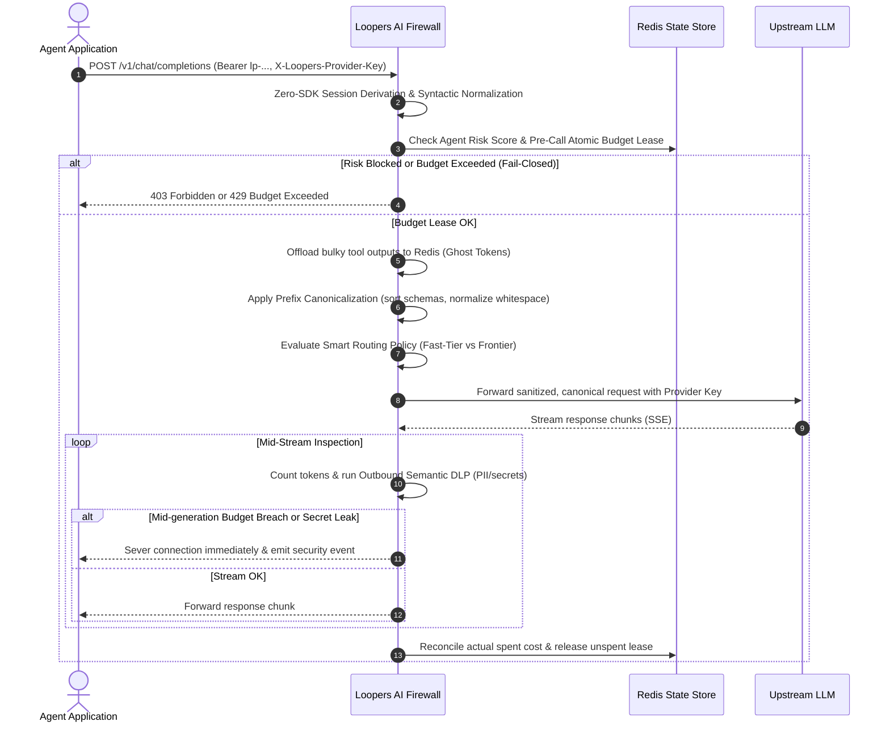

# Architecture Overview

Loopers is designed as a high-performance **Dual-Regime AI Firewall** that sits between your application and AI providers. It acts as a transparent, stateful reverse proxy, executing real-time threat mitigation when agents misbehave ("Bad Days") alongside inline context compression on healthy everyday traffic ("Normal Days") without requiring agent SDK rewrites.

## The Dual-Regime Firewall Architecture

```
┌────────────────────────────────────────────────────────────────────────┐
│                             Agent Runtime                              │
│       (Aider / Claude Code / OpenHands / LangChain / Python SDK)       │
└───────────────────────────────────┬────────────────────────────────────┘
                                    │ HTTP / SSE (e.g., OPENAI_BASE_URL)
                                    ▼
┌────────────────────────────────────────────────────────────────────────┐
│                      Loopers AI Firewall (:8080)                       │
│                                                                        │
│ ┌────────────────────────────────────────────────────────────────────┐ │
│ │          REGIME 1: ROGUE AGENT DEFENSE & THREAT MITIGATION         │ │
│ │                     ("Bad Days" Protection)                        │ │
│ │  [1. Key Auth & DPoP] ──► [2. Risk Score & Quarantine Gate]        │ │
│ │  [3. Syntactic Normalizer] ──► [4. Multi-Turn Drift Containment]   │ │
│ │  [5. Pre-Call Budget Lease] ──► [6. OPA / YAML Policy Engine & FSM]│ │
│ │  [7. Multi-Engine Loop Detector] ──► [8. Outbound Semantic DLP]    │ │
│ └────────────────────────────────────────────────────────────────────┘ │
│                                   │                                    │
│ ┌────────────────────────────────────────────────────────────────────┐ │
│ │         REGIME 2: INLINE CONTEXT ACCELERATION & WIRE FINOPS        │ │
│ │                    ("Normal Days" Optimization)                    │ │
│ │  [A. Zero-SDK Session Derivation]                                  │ │
│ │  [B. Ghost Token Side-Channel Offload (Redis AES-256-GCM / HKDF)]  │ │
│ │  [C. Dynamic Tail-Hydration (Frontier Synthesis vs Fast-Tier)]     │ │
│ │  [D. Deterministic Prefix Canonicalizer (KV Cache Maximization)]   │ │
│ │  [E. Smart Fast-Tier Model Routing & Warm Cache Pinning]           │ │
│ └────────────────────────────────────────────────────────────────────┘ │
│                                   │                                    │
│  Admin Server (:9090): /metrics (Prometheus) | /health                 │
│  Telemetry: OpenTelemetry Traces (OTLP gRPC/HTTP) | HMAC Webhooks      │
└───────────────────┬──────────────────────────────────┬─────────────────┘
                    │                                  │
                    ▼                                  ▼
          ┌───────────────────┐              ┌───────────────────┐
          │     Redis 7+      │              │ Upstream Provider │
          │ (Atomic Leases,   │              │ (OpenAI, Anthropic│
          │  Encrypted Ghosts,│              │  Gemini, Bedrock, │
          │  FSM Session State│              │  DeepSeek, Groq...)│
          │  Quarantine Keys) │              └───────────────────┘
          └───────────────────┘
```

---

## System Components

* **Your Application**: Any autonomous AI agent, script, or orchestrator. It connects to Loopers using standard OpenAI, Anthropic, or Gemini client SDKs simply by setting the base URL.
* **Loopers AI Firewall**: The core Go proxy server. Intercepts traffic in sub-2ms, running security checks, budget leases, token canonicalization, and ghost hydration in memory.
* **Redis Cache (7+)**: Distributed state backend handling atomic Lua leases, encrypted ghost token blobs (AES-256-GCM), prompt similarity fingerprints, and agent risk identities.
* **AI Provider**: The upstream LLM provider (OpenRouter, DeepSeek, OpenAI, Anthropic, Gemini, Mistral, Bedrock) processing completions.

---

## Request Flow



---

## Dual-Regime Architectural Guarantees

### Zero Storage of Keys & In-Memory Privacy
Real provider keys and unencrypted payloads reside strictly in volatile memory during transit. No prompts or keys are persisted to unencrypted disk or persistent databases.

### Fail-Closed Design
If Redis or the firewall fails, Loopers immediately shuts the door, rejecting incoming calls to protect against unauthorized spend and unshielded network egress.

### Ghost Token Side-Channel Offloading
Large tool responses (e.g. MCP database dumps or filesystem reads >512 bytes) are encrypted using AES-256-GCM with HKDF-derived keys and stored ephemerally in Redis. In the LLM prompt, they are replaced by ~80-token schema-compliant Ghost Stubs, delivering **65% to 75% input token compression**.

### Dynamic Prompt Tail-Hydration
When an agent reaches a turn requiring frontier synthesis (`!isSimpleTurn`), Loopers automatically hydrates the prompt tail with the full decrypted context (`<loopers_hydrated_context>`), ensuring zero quality degradation for complex reasoning.

### Deterministic Prefix Canonicalization
Loopers sorts tool schemas and normalizes variable headers/whitespace so that repeated prompts match the upstream provider's KV cache (Anthropic prompt cache, OpenAI prefix cache), unlocking up to 90% cost savings on cached tokens.
